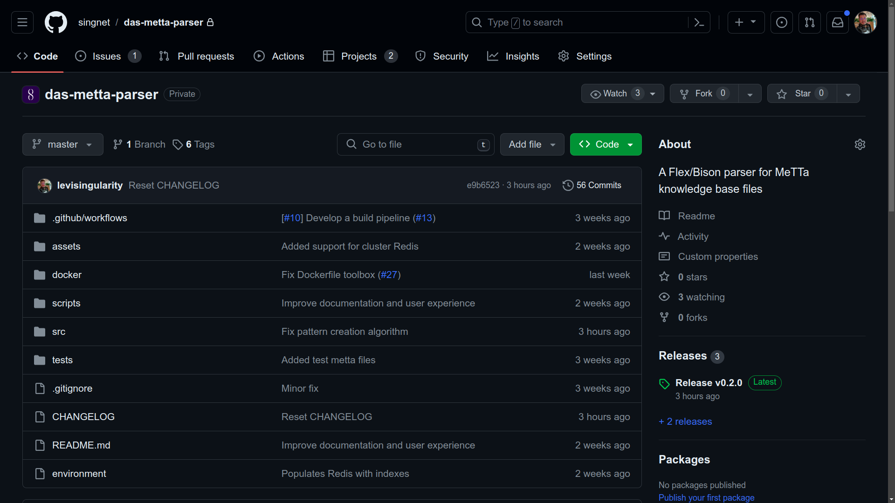
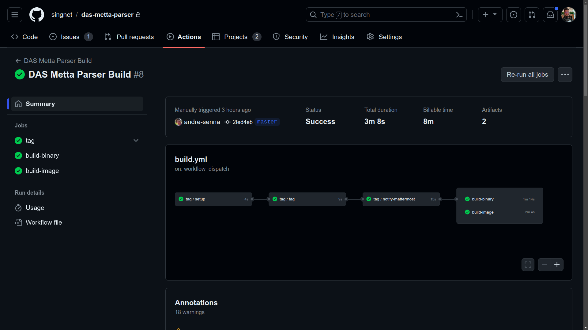
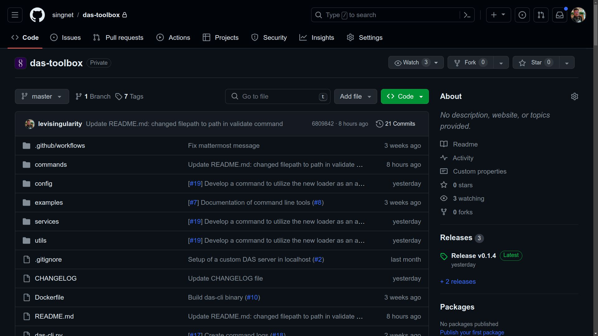
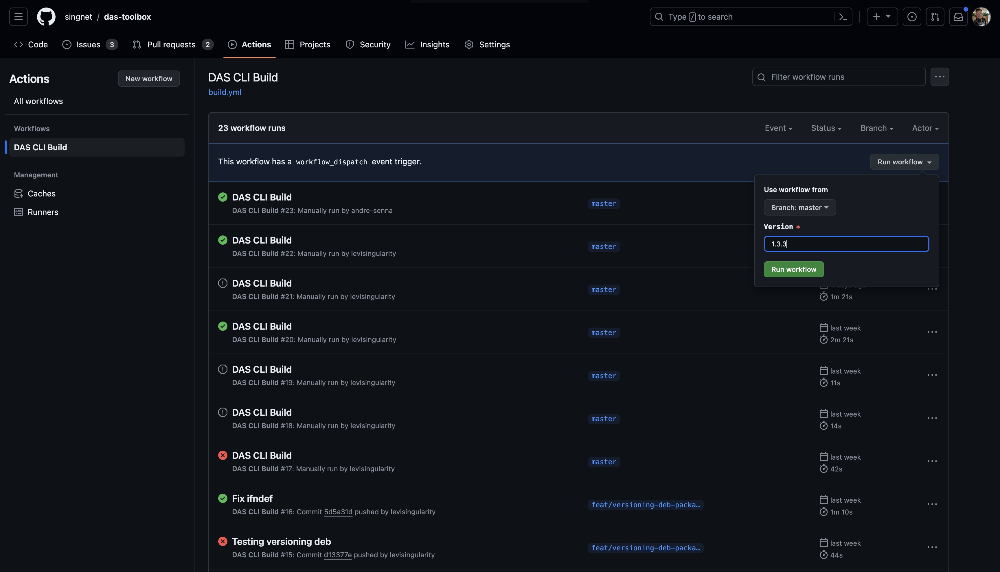
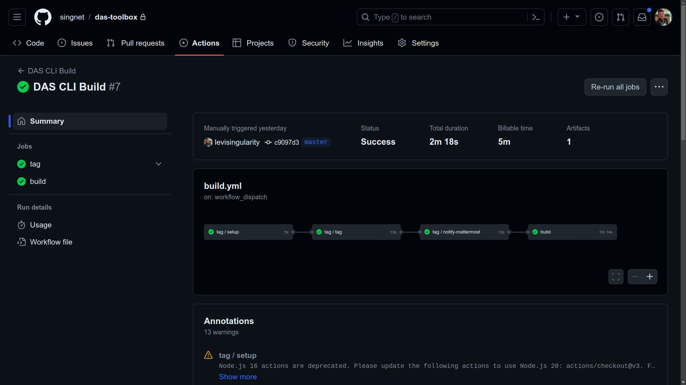
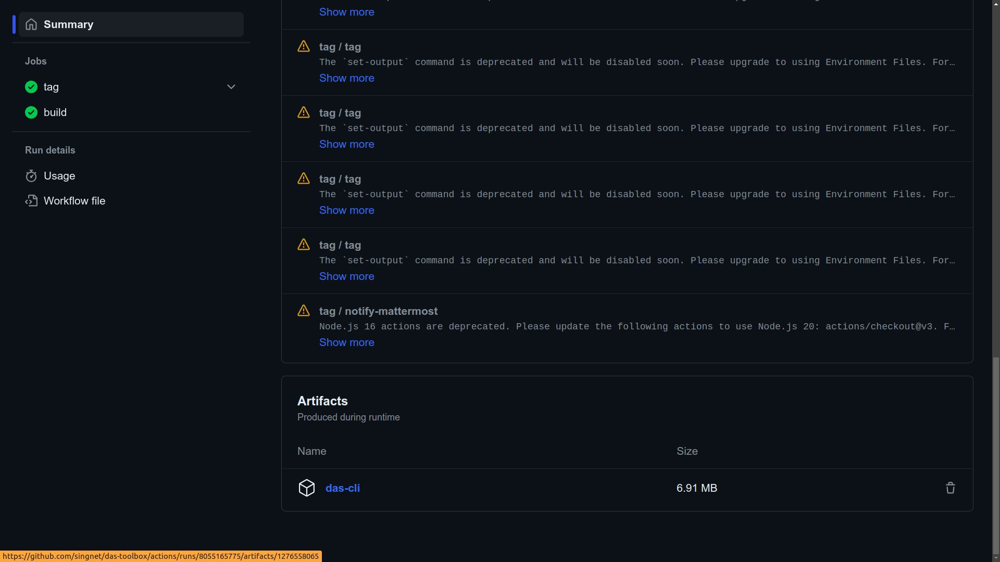

## New Version of DAS Metta Parser

1.  Go to the repository at the [<u>DAS Metta Parser repository</u>](https://github.com/singnet/das-metta-parser).

To publish a new version of DAS Metta Parser, access the repository at[<u>https://github.com/singnet/das-metta-parser</u>](https://github.com/singnet/das-metta-parser)

2.  Verify latest created tag before versioning

It is important to note what the last version created was at [<u>https://github.com/singnet/das-metta-parser/tags</u>](https://github.com/singnet/das-metta-parser/tags) before creating a new version.

3.  Execute DAS Metta Parser Build Workflow

Initiate the 'DAS Metta Parser Build' Workflow Manually via the 'Actions' Tab in the Repository. Click 'Run workflow' and proceed with the provided instructions, ensuring the master branch is selected. Enter the desired version number in the format 1.0.0, then click 'Run workflow' to proceed.

4.  Monitor the workflow execution. Ensure all jobs complete successfully.

Refresh the page and check if a new workflow is running. By clicking on it, you can track all jobs. At the end of the process, all jobs should have a green check mark. If there is an error in any job, it is possible to click on it to view the logs and identify the cause of the problem.

5.  Verify the new tag at DAS Metta Parser repository tags and Docker Hub.

It is important to note that this pipeline should generate an image on Docker Hub, following the format **1.0.0-metta-parser**. Make sure that the image is generated correctly and available at [<u>https://hub.docker.com/r/trueagi/das/tags</u>](https://hub.docker.com/r/trueagi/das/tags). After the workflow execution, verify if all jobs were successfully completed. The new version tag should be available at [<u>https://github.com/singnet/das-metta-parser/tags</u>](https://github.com/singnet/das-metta-parser/tags).

## New version of DAS Toolbox

1.  Go to the DAS Toolbox repository.

To publish a new version of DAS Toolbox, access the repository at [<u>https://github.com/singnet/das-toolbox/</u>](https://github.com/singnet/das-toolbox/).

2. Update the toolbox image version in **das-cli/src/settings/config.py**

 Before continue with the release process, update the `VERSION` constant in the `das-cli/src/settings/config.py` file. This file holds the version displayed when running `das-cli --version`. It is important to keep this version in sync with the version generated by the pipeline to avoid mismatches.

3.  Commit this change to the master branch.

After this change, it is necessary to commit to the master branch to record the change.

2.  Verify latest created tag before versioning

It is important to note what the last version created was at [<u>https://github.com/singnet/das-toolbox/tags</u>](https://github.com/singnet/das-toolbox/tags) before creating a new version.

3.  Run the "DAS CLI Build" workflow from Actions.

Manually execute the “DAS CLI Build” workflow through the “Actions” tab in the repository. Click 'Run workflow' and proceed with the provided instructions, ensuring the master branch is selected. Enter the desired version number in the format 1.0.0, then click 'Run workflow' to proceed.

4.  Monitor the workflow execution. Ensure all jobs complete successfully.

After the workflow execution, refresh the page and check if a new workflow is running. By clicking on it, you can track all jobs. At the end of the process, all jobs should have a green check mark. If there is an error in any job, it is possible to click on it to view the logs and identify the cause of the problem.

5.  Verify the new tag at DAS Toolbox repository tags

After the workflow execution, verify if all jobs were successfully completed. The new version tag should be available at [<u>https://github.com/singnet/das-toolbox/tags</u>](https://github.com/singnet/das-toolbox/tags). Additionally, the CLI file generated by the pipeline will be available for download in the workflow artifacts, allowing its use locally.

